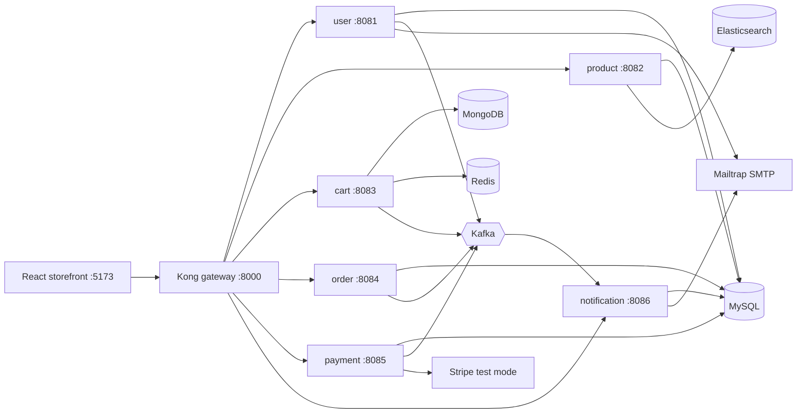

# SwiftBasket

A microservices e-commerce platform: browse and search a catalog, keep a cart as a guest or signed-in user, check out, pay with Stripe in test mode, and get email notifications. Six Spring Boot services sit behind a Kong gateway and communicate over Kafka. A React storefront and admin panel run on top.

## Architecture



| Service | Port | Responsibility | Storage |
| --- | --- | --- | --- |
| [user](backend/user-service/README.md) | 8081 | Registration, login (JWT), profile, password reset | MySQL `user_db` |
| [product](backend/product-service/README.md) | 8082 | Catalog, categories, admin CRUD, full-text search | MySQL `product_db`, Elasticsearch |
| [cart](backend/cart-service/README.md) | 8083 | Guest and user carts, merge on login | MongoDB, Redis cache |
| [order](backend/order-service/README.md) | 8084 | Checkout, stock reservation, order history, fulfillment status | MySQL `order_db` |
| [payment](backend/payment-service/README.md) | 8085 | Stripe payment intents, confirmation, receipts, webhooks | MySQL `payment_db` |
| [notification](backend/notification-service/README.md) | 8086 | Event-driven emails and notification history | MySQL `notification_db` |

Each service's README lists its endpoints, events, and configuration; the [frontend README](frontend/README.md) covers the storefront.

Kong validates the JWT on protected routes and forwards the caller's identity as `X-User-ID` and `X-User-Role` headers. Services enforce authorization. Kafka carries `user.registered`, `cart.item.added`, `order.placed`, `payment.completed`, `payment.failed`, and `order.status.updated` events.

## Prerequisites

| Tool | Version |
| --- | --- |
| JDK | 17 or newer |
| Maven | 3.9+ (each service also includes `./mvnw`) |
| Node.js | 22 LTS |
| Podman with `podman-compose`, or Docker with Compose | Recent |
| Python 3 and `curl` | Used by the catalog seed script |

You'll also need free accounts for:
- [Stripe](https://dashboard.stripe.com/register): a test-mode secret key (`sk_test_…`).
- [Mailtrap](https://mailtrap.io/): SMTP credentials for an Email Testing inbox.

## Setup

### 1. Clone and configure secrets

```sh
git clone https://github.com/mehulanshumali/SwiftBasket.git
cd SwiftBasket
cp scripts/.env.example scripts/.env
chmod 600 scripts/.env
```

Fill in `scripts/.env`. Never commit real credentials.

| Variable | Purpose |
| --- | --- |
| `STRIPE_API_KEY` | Stripe **test** secret key |
| `STRIPE_TEST_PAYMENT_METHOD_ID` | `pm_card_visa` shows the test **Pay** button |
| `STRIPE_WEBHOOK_SECRET` | Optional; only for signed webhook testing |
| `MAILTRAP_USERNAME`, `MAILTRAP_PASSWORD` | Mailtrap SMTP credentials |
| `JWT_SECRET` | 64+ byte random string: `openssl rand -base64 64 \| tr -d '\n'` |

### 2. Start infrastructure and services

**Podman (recommended).** The service manager starts the containers, then each service in dependency order, waiting for health checks:

```sh
podman machine start          # macOS/Windows only
bash scripts/swiftbasket.sh start all
bash scripts/swiftbasket.sh status
```

The first run downloads images and Maven dependencies and takes a few minutes. MySQL creates the databases from [`infra/mysql_init.sql`](infra/mysql_init.sql) on first start.

**Docker.** Start the containers, then run each service in its own terminal, in this order: user, product, cart, order, payment, notification.

```sh
docker compose -f infra/docker-compose.yml up -d
set -a; source scripts/.env; set +a
cd backend/user-service && ./mvnw spring-boot:run
```

See [docs/infrastructure.md](docs/infrastructure.md) for container ports and compose commands.

### 3. Start the storefront

```sh
cd frontend
npm ci
npm run dev
```

Open http://localhost:5173. Vite proxies `/api` to Kong on port 8000.

### 4. Create an admin and seed the catalog

1. Register an account in the storefront.
2. Promote it to admin:

   ```sh
   podman exec -i swiftbasket-mysql mysql -uswiftbasket_user -psecurepass user_db \
     -e "UPDATE users SET role = 'ADMIN' WHERE email = 'you@example.com';"
   ```

   With Docker, use `docker exec` instead of `podman exec`. Sign out and back in so your token includes the new role.
3. Load the sample catalog (categories, products, and images) from [`docs/seed_data.json`](docs/seed_data.json). Run it once on an empty catalog:

   ```sh
   bash scripts/feed_data.sh
   ```

   It prompts for the admin email and password, then rebuilds the search index.

## Try it end to end

1. Add products to the cart as a guest, then sign in; the guest cart merges into your account.
2. Go to **Cart → Checkout**, enter an address, and click **Continue to payment**.
3. Click **Pay**. Stripe test mode charges `pm_card_visa`; no real money moves.
4. Check **Account → Orders** for the receipt and **PAID** status, **Account → Notifications** for email history, and your Mailtrap inbox for the emails.
5. Use **Forgot password** to test the reset email; its link opens the storefront.
6. As an admin, choose **Admin** from the **Account** menu to manage products, categories, and order fulfillment.

Each service documents its API at `http://localhost:<port>/swagger-ui.html`.

## Service manager

```sh
bash scripts/swiftbasket.sh start [service|infra|all]
bash scripts/swiftbasket.sh stop [service|infra|all]
bash scripts/swiftbasket.sh restart <service>
bash scripts/swiftbasket.sh status
bash scripts/swiftbasket.sh logs <service>
```

Services are `user`, `product`, `cart`, `order`, `payment`, and `notification`. Use `logs <service>` to follow a service's output.

## Tests

```sh
mvn -f backend/<service>-service/pom.xml test
npm --prefix frontend run build    # production build and type check
npm --prefix frontend run lint
```

Backend tests load the full Spring context, so start the infrastructure first.

## Troubleshooting

| Symptom | Fix |
| --- | --- |
| Kong returns `502` | The Spring services aren't running; run `bash scripts/swiftbasket.sh status`. |
| `port … already in use` on start | Stop the stray process: `bash scripts/swiftbasket.sh stop <service>`. |
| `Unresolved compilation problems` in a service log | Your IDE wrote incomplete classes that DevTools hot-reloaded. Run `bash scripts/swiftbasket.sh stop <service> && mvn -q -f backend/<service>-service/pom.xml clean compile && bash scripts/swiftbasket.sh start <service>`. |
| No **Pay** button | Set `STRIPE_API_KEY` to a test key and `STRIPE_TEST_PAYMENT_METHOD_ID`, then restart payment. |
| Emails marked **FAILED** with `Too many emails per second` | Mailtrap's free plan rate-limits sending; the sender serializes and retries, but bursts can still fail. |
| Catalog is empty | Run the seed script (step 4). |

## Project layout

```
backend/        Six Spring Boot services (Java 17, Spring Boot 3.5)
frontend/       React + TypeScript storefront and admin panel (Vite)
infra/          Compose files, Kong declarative config, MySQL schema
scripts/        Service manager, catalog seed script, env template
docs/           Product requirements, infrastructure guide, seed data
```

See [docs/PRD.md](docs/PRD.md) for the original product requirements.

## Security

The database passwords in `infra/` and the service configs are local development defaults. Change them, and supply real secrets through environment variables, before deploying anywhere shared. Payments run in Stripe test mode only.
